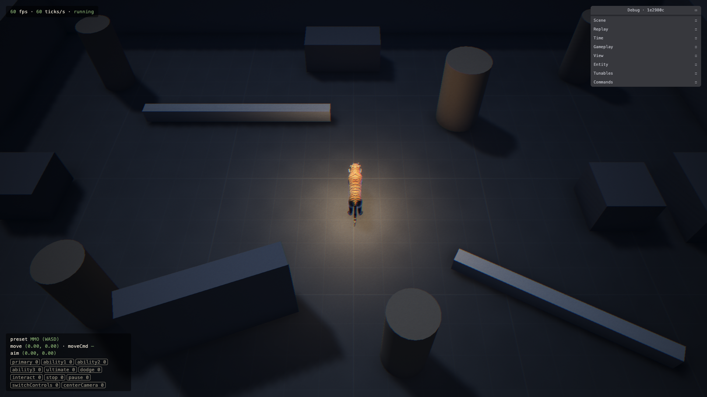

# 2.2.1 cf preview output

> 2026-10-17 · [plan](../../slopdocs/plans/2.2.1-cf-preview-output.md)

## What we built

We upgraded cf from 1.0.0-beta.12 to 1.0.0-beta.18 and removed the preview output-file shim introduced in 1.6.1. cf now writes the result Workers Builds needs to report the stable branch URL and the individual deployment URL on a PR.

## Key decisions

- Workers Builds now runs `pnpm exec cf previews deploy` directly after `pnpm typecheck`. We applied the command to existing previews as well as the base configuration.
- We kept the app's static-assets-only configuration. It has no secret bindings to migrate or exercise; the deployment docs explain using `bindings.secret()` if secrets are added later.
- This maintenance branch started from main so it could be reviewed independently of the open ability-framework PR.

## Verification

Local `pnpm check` passed: typecheck, Biome and 350 tests across 42 files. `pnpm build` passed, with the existing bundle-size warning. The fresh Workers Builds preview passed all five PR checks. Build `673e19ad` deployed `1e2980c` to the stable branch URL and deployment `b80cd3cb`; cf printed both URLs without the wrapper. The live app rendered at 60 fps with `crossOriginIsolated === true`, COOP/COEP and `noindex` headers. Redeployment verification follows in the PR.
