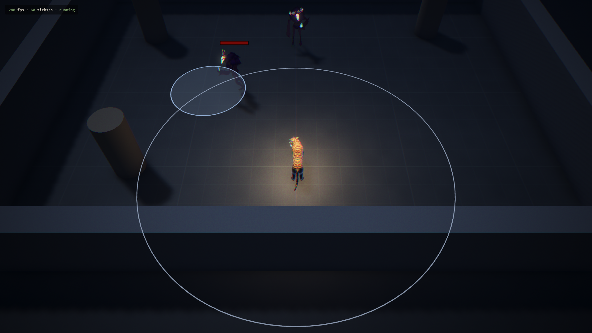
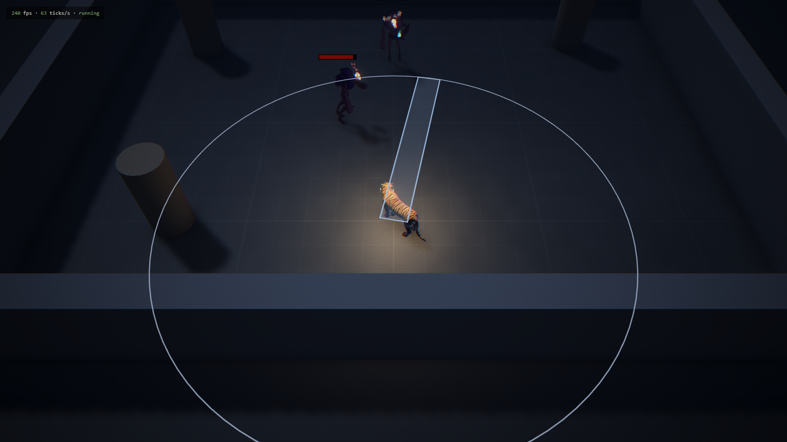
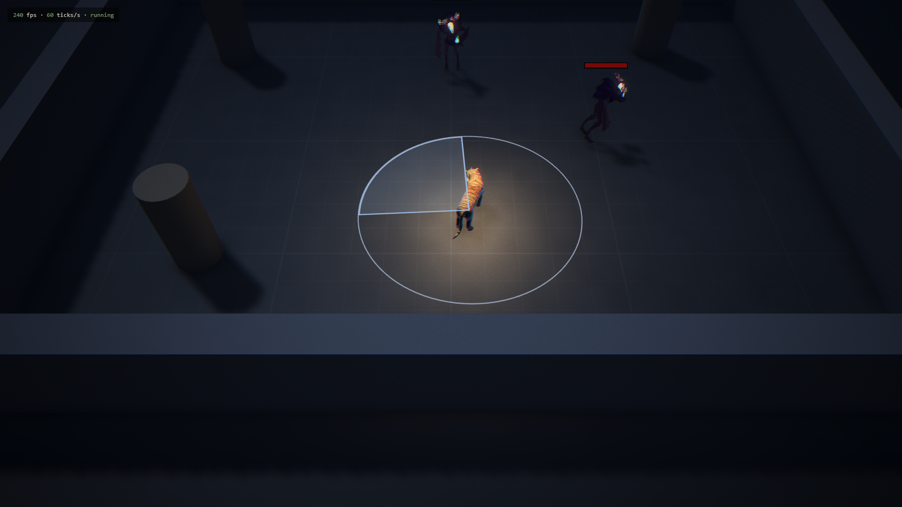
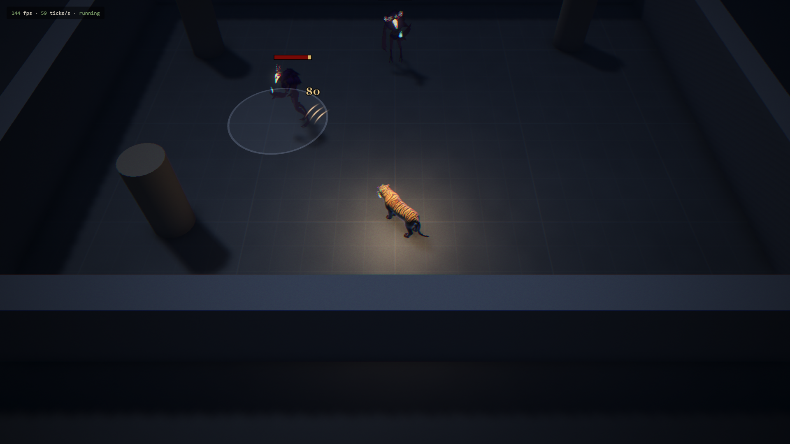
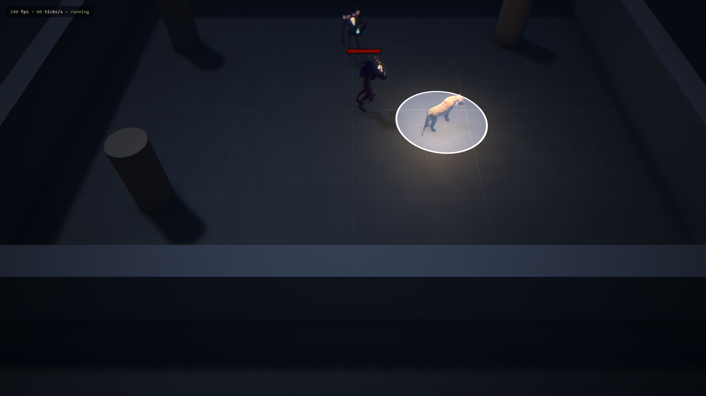
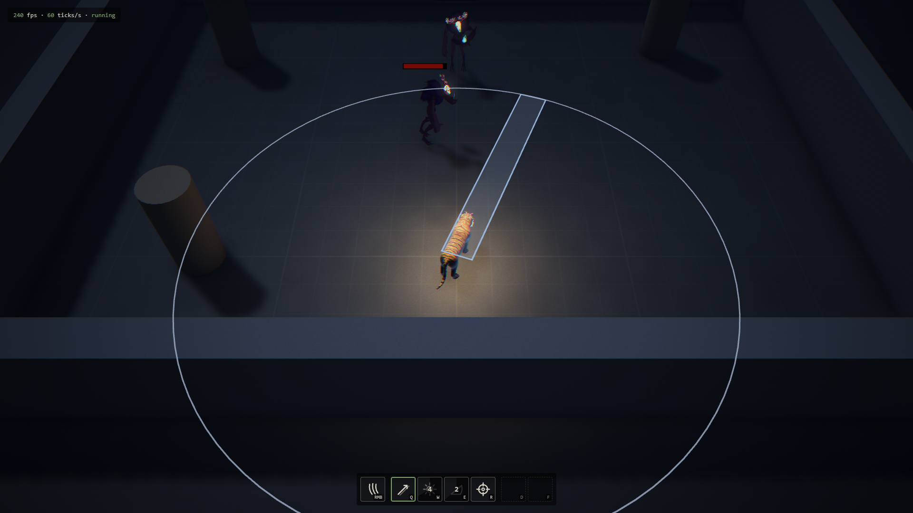

# 2.3 Keybinds & Dodge Decision

> 2026-10-24 · [plan](../../slopdocs/plans/2.3-keybinds-and-dodge.md)

## What we built

The ability keys are settled for good, and dodge is decided: there isn't one. `Q`/`W`/`E`/`R` are the loadout, and `D`/`F` are two empty slots reserved for something outside it. Every slot key has League's three cast modes. The plain key quick casts at the cursor. `Shift` + the key is a normal cast: a range ring and the ability's shape follow the cursor until a left click casts it. `Alt` + the key self casts. A targeted ability on an enemy that's out of range walks the cat into range, then casts. No real abilities exist yet (pounce is 2.4), so a dev-only **test kit** in the debug pane fills the empty slots with four grey-box abilities: a line, a self-castable burst, a cone and a targeted strike.

## Key decisions

- **No dedicated dodge.** A universal dodge on a short cooldown would flatten the forms and turn every telegraph into a button press. Mobility lives in each form's abilities instead, and a form can have a dodge-like one (a sidestep, a roll, a blink). It's League's answer, not Hades'.
- **D/F reserved, for now empty.** Like League's summoner keys: two slots outside the form's loadout, maybe items, consumables or relic actives. They exist in code as `extra1`/`extra2`, so the first thing that goes there only needs a definition.
- **Cast modes are chords in the bindings.** `Shift+Q` presses `ability1` together with a `normalCast` action, `Alt+Q` with `selfCast`. The simulation only reads actions, replays record them, and remapping (16.1) can move any mode to any key without touching the sim.
- **League's rules for a normal cast.** A left click confirms. A right click cancels and still gives its move order, so no click is wasted. Esc cancels without opening the pause menu. Nothing is spent until the cast is confirmed. Aiming is only UI, so you can aim during the auto attack's windup, and the cast follows right after it.
- **Self cast only where it makes sense.** Abilities opt in with a flag (the test burst lands at the cat's feet). On the rest, `Alt` changes nothing, so holding it never swallows a press.

## Surprises & problems

- **Built by four agents at once.** After a small commit that fixed the shared names (actions, slots, the aiming state), input, simulation, test kit and view were built in parallel, each in its own git worktree, and merged one by one. The only conflict was a few lines in the shell.
- **The aim waited on the auto attack.** As planned, a normal cast could only be armed with no other cast running. But the auto attack's windup (0.26 s) is longer than the 0.2 s press buffer, so `Shift+Q` during an auto was silently dropped. Aiming doesn't change the fight, so it's now allowed at any time.
- **Alt belongs to the browser.** Firefox opens its menu bar on a lone Alt. The game now cancels Alt while it has focus, but only Alt itself and our bound `Alt+` chords: Alt + arrows still goes back in history.
- **No GPU in headless Chrome on WSL.** SwiftShader lost its WebGPU device, and WSL's Vulkan path rendered a white canvas at 2 fps. We switched WSL to mirrored networking, so agent-browser now drives a headless Windows Chrome on the real GPU over a localhost-only debug port. It came with one trap: with mirrored ports, a Windows connection lingering in TIME_WAIT on 5746 blocks the dev server from starting.
- **The replay fixtures didn't move.** Every new piece of state is absent until it's used, so the old recordings replay bit for bit. A new `yard-cast-modes` fixture covers each mode, a cancelled aim and the walk into range.

## Media

After the first playtest the kit became the Cat's loadout from the start, and a minimal ability bar joined it: icons, keys, cooldowns, and an outline on the slot being aimed.

